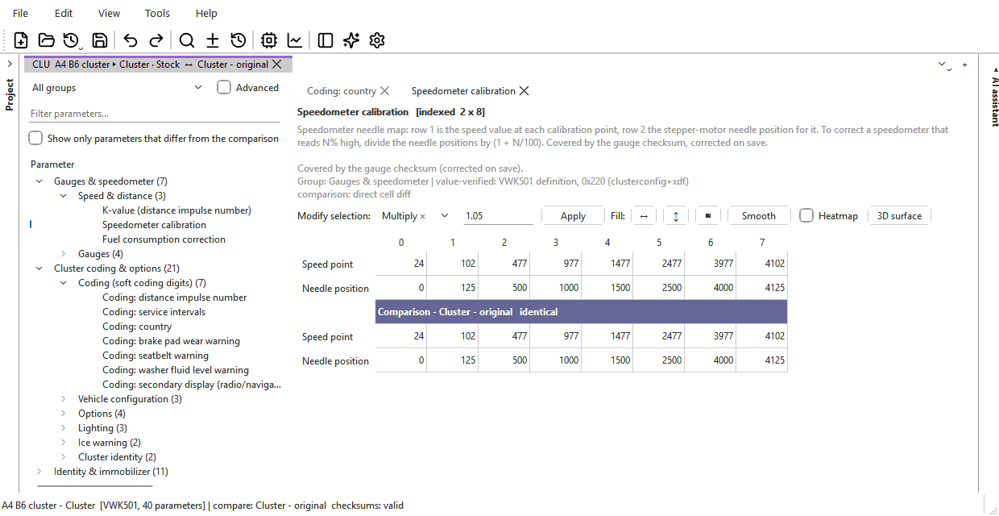

# VDO Cluster

The VDO Cluster module works on the EEPROM of the VDO instrument clusters
fitted to VW-group cars of the Mk4 / B5 era (Golf, Jetta, Bora, Passat,
Polo, Fabia, Octavia). The cluster's program is in mask ROM and cannot be
changed; everything a tuner, an engine swap or a cluster replacement
touches — the speedometer K-value, the gauge needle maps, the soft coding,
the options, the immobiliser data, the VIN and the odometer — sits in its
2 KB (2048-byte) serial EEPROM. This module:

- names every field of that EEPROM it knows, grouped like any other file's
  parameters, with drop-down choices for the coding options;
- keeps the cluster's own checksums correct when you save;
- applies needle-sweep, LED-sweep and DSG-needle patches made for your exact
  cluster ROM;
- adds the cluster mode of the speed and distance tool (K-value and
  speedometer needle correction).

## Pages in this section

- [The cluster EEPROM](eeprom.md) — what each group of fields is, what is
  safe to edit, the checksums, and the `.vdo` file.
- [Reading and writing the cluster](read-write.md) — over K-line: reading,
  and writing the whole EEPROM with a read-back check.
- [Needle and LED sweep patches](needle-sweep.md) — **Tools > VDO Cluster >
  Needle sweep...**, and who made each patch.
- [Speed and distance](speed.md) — K-value from tyre size or a measured
  error, and needle-only correction.

## Supported clusters

The app recognises a file as a cluster EEPROM from the EEPROM's own
structure: it must be exactly 2048 bytes and carry the gauge checksum and the
immobiliser-ID field at the addresses one of the two physical layouts uses.
Nothing is guessed from the content. Within a layout, a definition file per
ROM family names the fields:

| ROM family | Cars | ROM builds known | Layout | Definition |
|---|---|---|---|---|
| VWK501 | VW Mk4 / B5 era | VWK501LL 00.88, VWK501MH 00.88, VWK501MH 00.92, VWK501LL 01.00, VWK501MH 01.00, VWK501MH 01.10 | VWK501 | verified |
| VWK503 | VW Mk4 / B5 era | VWK503LL 09.00, VWK503MH 09.00 | VWK503 | verified |
| VMMJ08 | VW Mk4 (late) | VMMJ08MH 09.00 | VWK503 | verified (same addresses as VWK503) |
| VQMJ07 | Polo 9N / Fabia | VQMJ07HH 08.40, VQMJ07LM 08.40, VQMJ07LM 09.00 | VWK503 | **extrapolated** |
| K5MJ07 | Skoda Octavia | K5MJ07HH 09.00, K5MJ07LM 08.10, K5MJ07LM 09.00 | VWK503 | **extrapolated** |

**Extrapolated** means only the identity fields — VIN, both VIN slots,
immobiliser ID, key and key data, number of keys, adaptation status, SKC,
odometer, odometer check value and the radio cluster ID — are confirmed for
that family. Every other field is assumed to sit where it does on VWK503 and
has not been checked against a real EEPROM. Such a file opens with a warning,
and each unconfirmed field's description says **UNCONFIRMED**. Back up and
check before writing an edit to one of those fields. VQMJ07 and K5MJ07 have
no known patch-module location, so sweep patches cannot be placed on them.

The ROM build (for example `VWK501MH 01.10`) decides more than the family:

- **LL** builds are lowline clusters. Fields marked "not present on lowline"
  (ice warning, distance to empty, welcome message, and on VWK503 the outside
  temperature source) are left out of the tree for them.
- A sweep patch only runs on the exact build it was written for.

## How the app knows the ROM build

In order of authority:

1. **The cluster's own answer.** A read from the cluster by this app (or a
   `.vdo` of an earlier version) records the software version the cluster
   reported. Nothing overrides it.
2. **The patch-module header.** If the EEPROM carries a valid patch block,
   its header names the ROM build it was made for.
3. **The layout alone.** A plain `.bin` imported with no patch block shows the
   layout's fields, and the file information says the exact ROM build is not
   known.

**File > File information...** shows what was found: the definition and its status, the layout, the ROM version and where
it came from, lowline or not, the vehicle family, the VIN, part number,
immobiliser ID, SKC, the odometer, and whether the checksums are valid.

## A typical job

1. Read the cluster with **Tools > ECU read / write...**, ECU
   **Cluster (VDO K-line)**, **Read flash** — see
   [Reading and writing the cluster](read-write.md). The EEPROM goes into a
   project. Save it straight away: that is your backup with the cluster's
   own ROM version in it, and the only one — the write keeps no copy of what
   the cluster held.
2. Change what you need: coding options in the tree, the K-value or needle
   map with **Tools > VSS pulse settings...**, a sweep patch with **Tools >
   VDO Cluster > Needle sweep...**.
3. Save (Ctrl+S). The gauge checksum (and a patch block's header checksum)
   are corrected as the version is saved.
4. Write it back with **Write flash** in the same dialog. The whole EEPROM
   is written — everything in it, vehicle data included, replaces what
   the cluster holds — and each block is read back to check it.
5. Switch the ignition off and on so the cluster reloads its EEPROM.

## Asking the AI

The [AI assistant](../../ai.md) can read the cluster's identification, its
K-value and speedometer maps, and work out a new K-value for a tyre change or
a measured speed error — *"I fitted 255/40 R19 instead of 245/45 R18, what
K-value?"*. It lists the sweep patches that fit this exact ROM build, and can
propose one for you to review. The VIN, immobiliser ID and SKC are never
shown to it, and it cannot change them. See [What the AI
knows](../../ai/what-it-knows.md).

## Without the module

The base app still recognises a cluster EEPROM, imports it into a project
(in the hex editor), and reads and writes it with the flasher. Without the module the write
confirmation lists the changed 16-byte blocks instead of field names, and
the flasher asks before writing an image whose checksum it cannot correct. See
[Modules](../../modules.md).
