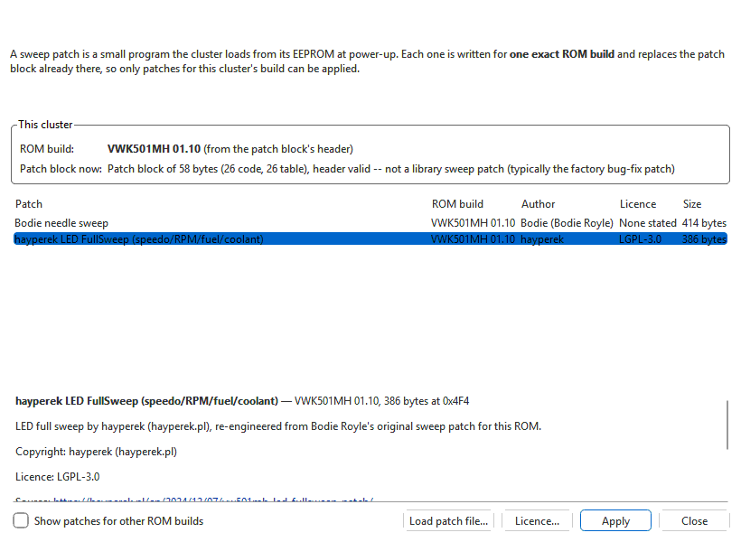

# Needle and LED sweep patches

**Tools > VDO Cluster > Needle sweep...** puts a *sweep patch* into the open cluster
EEPROM: the needles (and on some patches the LEDs) sweep to full scale and
back when the ignition is switched on. There are also DSG-needle patches.

A sweep patch is a small program the cluster loads from its EEPROM into RAM
at power-up — the same place, the *patch module*, where VDO keeps its own
factory bug-fix patch. Each patch is written for **one exact ROM build**: the
cluster only loads a block whose header names its own build, and code for
another build would patch the wrong addresses. So the dialog only lets you
apply a patch made for your cluster's build.

The menu item is available when the tab in front holds a cluster EEPROM and
the VDO Cluster module is installed. VQMJ07 and K5MJ07 clusters have no known
patch-module location: for them the app says so instead of opening the
dialog.

## Applying a patch

1. Open the cluster's project — ideally one made from a read of the cluster
   with this app, so its ROM build is known for certain (see
   [Reading and writing the cluster](read-write.md)).
2. **Tools > VDO Cluster > Needle sweep...**
3. Check **This cluster**: **ROM build** shows the build and where it came
   from; **Patch block now** describes the patch block the EEPROM carries.
4. Pick a patch in the list. The panel below shows its author, copyright,
   licence and source, and what it replaces.
5. **Apply** (or double-click the patch). Confirm.
6. Save (Ctrl+S), then write it to the cluster with **Tools > ECU read /
   write...** and **Write flash**. Nothing is sent to the car until you write.
7. Switch the ignition off and on to see the sweep.

Applying is one ordinary edit of the open file: **Edit > Undo** (Ctrl+Z)
takes it out again, and the change log records which patch was applied with
its credit and licence. The patch header checksum is part of the patch, and
the gauge checksum is corrected on save as always.

## The dialog

| Part | What it does |
|---|---|
| **ROM build** | The cluster's exact ROM build and how it is known: *reported by the cluster when it was read* (a read by this app, or a `.vdo` of an earlier version) or *from the patch block's header*. If neither, it says **not identified**. |
| **Confirm build** | Shown only when the build is not identified. Pick the build printed on the cluster's label to unlock the patches for it. |
| **Patch block now** | The patch block in the EEPROM now: a library patch by name, *No patch block loaded (header erased)*, or a block that is not a library patch — on a stock cluster, VDO's factory bug-fix patch. |
| Patch list | The patches for this cluster's build: **Patch**, **ROM build**, **Author**, **Licence**, **Size**. |
| Details panel | The patch's credit, copyright, licence, source link and notes. For a patch that cannot be applied, why not. |
| **Show patches for other ROM builds** | Also lists the rest, greyed, with the reason each one cannot be applied (hover over it). |
| **Load patch file...** | Loads a patch from disk (see below). |
| **Licence...** | The full licence text the selected patch is published under. |
| **Apply** | Applies the selected patch. |

## What a patch replaces

The patch area holds one block. Applying a sweep patch replaces whatever is
there — on a stock cluster, VDO's factory bug-fix patch. The app compares
the fix routines of the block being replaced with the new patch's code and
tells you, in the details panel and again when you apply:

- *It replaces the patch block this cluster carries now and carries all N of
  its fix routines* — the sweep author kept the factory fixes; or
- *... carries only N of that block's M fix routines* — the factory fixes are
  lost. Some sweep patches are written that way; decide whether you need them.

## If the ROM build is not known

A plain `.bin` with no valid patch block does not say which build the cluster
runs. Either:

- read the cluster with this app (the read records the build), or
- pick the build printed on the cluster's label in **Confirm build**.

If you confirm a build, the app asks you to be sure: **a patch for the wrong
build can stop the cluster booting until its EEPROM is restored with a
programmer.** Only confirm a build you have read off the cluster itself.

## Loading a patch from a file

**Load patch file...** takes:

- a **`.patch`** file in KWHack's format (`Name:`, `Variant:`,
  `SoftwareVersion:`, `Address:`, `Credit:`, optionally `License:`, then
  `Data:` with the hex), the way many sweep patches are published; or
- a raw **`.bin`** patch block. Its header names the ROM build; if it fits
  more than one known build you are asked which. It is placed at this
  cluster's patch-module address.

A loaded patch goes through the same checks as the bundled ones: its own
header must verify, it must be for this cluster's build and this cluster's
patch-module address, and it must fit in the patch area.

## The bundled patches and their authors

The bundled library holds each author's published patch block unchanged,
under the author's own licence. **Help > Credits & licences...** lists them
under *Module data*, with the full licence texts (see
[About and credits](../../about.md)).

| Author | Patches | Licence | Source |
|---|---|---|---|
| Bodie (Bodie Royle) | Needle sweep for VWK501MH 00.92, 01.00, 01.10 and VWK503MH 09.00 | None stated — published on Graeme's Webspace (graeme86.com) with his permission, credited | graeme86.com |
| hayperek | LED FullSweep (speedo/RPM/fuel/coolant) for VWK501MH 00.92, 01.00, 01.10 and VWK503MH 09.00 | LGPL-3.0 | hayperek.pl |
| Feche | Needle/LED sweep & DSG needles for VMMJ08MH 09.00 and VCLM09MH 09.00; Needle sweep & DSG needles (LED sweep not yet supported) for VWK501LL 00.88 and 01.00 | LGPL-3.0-or-later | blog.feche.ar |
| SigurdMyhre | DSG needle, and DSG needle + startup sweep, for VWK501MH 01.00 | Apache-2.0 | github.com/SigurdMyhre/VWK501-DSG-Needle |
| gmenounos (Greg Menounos) | Needle sweep for VWK501MH 00.88, VWK502MH 09.00, VWK503LL 09.00, KB5M07HH 09.00 and VSQX01LM 01.00 | MIT | github.com/gmenounos/vwcluster |

Notes from the authors' pages, shown with each patch:

- Bodie's page states that his patch carries all the known factory updates,
  and that the sweep does not run on low voltage or when the needles are not
  zeroed.
- hayperek asks that the author be credited when the patches are reposted.

Some library patches are for ROM builds this module has no definition file
for. Such a patch is offered only when a cluster read with this app reports
that build and the patch fits the EEPROM's patch-module address.
