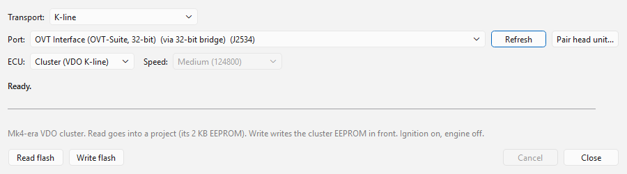

# Reading and writing the cluster

The cluster's EEPROM is read and written over **K-line** with the KW1281
protocol, at address 0x17, from **Tools > ECU read / write...** (Ctrl+E). The
general use of that dialog — cables, ports, the log — is in
[ECU read / write](../../flashing.md); this page covers what is particular to
the cluster. The flasher's own summary of this entry is on
[Other units](../../flashing/other-units.md#cluster-vdo-k-line).

## Before you start

- A K-line cable: a serial / FTDI KKL cable or a J2534 device with K-line.
  See [Cables and interfaces](../../cables.md).
- **Ignition on, engine off.**
- Pick **ECU: Cluster (VDO K-line)**. The dialog switches to K-line by itself
  and locks the speed: the cluster always uses the 5-baud slow init at 10400
  baud. (The plain **Cluster** entry in the list is a different, CAN-based
  cluster.)

Reading and writing work whether or not the VDO Cluster module is
installed; the module names the changed fields in the write confirmation
(without it, the changed 16-byte blocks are listed) and corrects the
checksums.

## Reading

1. Choose the port, then **Read flash**.
2. The app connects (it tries three times), reads the cluster's
   identification and software version, unlocks the cluster for EEPROM
   access — with the unlock code known for that software version, or, if it
   has none, by trying every known code — and logs in with the seed/key
   when the cluster asks for it.
3. The 2048 bytes are read in 16-byte blocks.
4. The EEPROM goes into a project, like every read — with a project tab in
   front you are asked **Add to <project>** or **New project** — and opens
   in a tab named after the ROM build, for example
   *Cluster-VWK501MH_01.10-142233*. Save it: the project keeps the software
   version the cluster reported (see [The .vdo file](eeprom.md#the-vdo-file)).

In the standalone **OVT Flasher** the read is not opened in a tab; it is
saved as an `.ovt` project by default, or as the raw image (`.bin`).

## Writing

**Write flash** writes the EEPROM in the tab in front.

1. If you want to keep what the cluster holds now, **Read flash** first and
   save the read. The write does not read the cluster and keeps no copy of
   its own, so that read is the only way back.
2. Open the cluster's project (or read the cluster) and make your changes.
3. **Write flash**. With unsaved changes you are asked first: **Save, then
   write**, **Write without saving** or **Cancel**. The app then asks to
   confirm, listing what changed since the tab was opened. Everything in the
   image replaces what the cluster holds, including its vehicle data (immobiliser, VIN, odometer).
4. The write then:
   - checks the file: it must be a recognised VDO Mk4 cluster EEPROM, or the
     write stops before the cluster is touched;
   - connects and unlocks as for a read;
   - writes **the whole EEPROM**, all 128 blocks of 16 bytes;
   - reads every block back and compares it.
5. The result says the whole EEPROM was written and verified, and the
   version written is marked in the project as last flashed. Switch the
   ignition off and on: the cluster reloads the EEPROM at power-up.

The checksums are corrected in the image that is sent, so you do not have to
save first — but do save, so the project's history holds what the cluster
holds.

### Nothing is read before the write

The write sends the file as it is. It does **not**:

- read the cluster or save a backup of it;
- compare the file's EEPROM layout with the cluster's;
- compare the file's vehicle data — VIN, immobiliser data, SKC, odometer
  and the rest of the **Identity & immobilizer** group — with the cluster's,
  or ask before replacing it.

So a file from another car or another cluster is written like any other, and
moves that vehicle's identity (immobiliser, VIN, odometer) into this cluster.
That is what you want when fitting a replacement cluster with the old one's
data, and nothing else. Check **File > File information...** before you
write a file you did not read from this cluster.

A file of a different layout — a VWK501-layout file on a VWK503-layout
cluster, or the other way round — is not caught either, and puts every field
at the wrong address. Carry data between layouts with a patch instead — see
[Moving data between clusters](eeprom.md#moving-data-between-clusters).

### Refused writes

- **Not a cluster EEPROM.** The file must be exactly 2048 bytes and a
  recognised VDO Mk4 layout; otherwise the write stops with *the file is not
  a recognised VDO Mk4 cluster EEPROM* before anything is sent.

## When something goes wrong

| Message | What to do |
|---|---|
| *The VDO cluster is K-line only* | Choose the K-line transport and a K-line cable or J2534 device. |
| *the cluster did not answer* | Check the ignition is on, the cable is in the diagnostic socket and the right port is picked. |
| *the controller at 0x17 answered with KWP2000 keyword ..., not KW1281 -- not a VDO Mk4-era cluster* | The cluster is a later type this page does not cover. |
| *Unknown cluster software version: EEPROM access will likely fail.* | No unlock code is known for this software version; the app tries the known ones. |
| *the cluster refused the seed/key login* | The cluster did not accept the login; access to the EEPROM is not possible this way. |
| *the cluster refused the write at ... -- the EEPROM may be partly written; write again* | Run **Write flash** again: the whole EEPROM is written again. |
| *verify failed at ...: the cluster reads back different bytes* | Write again. If it repeats, write the file you read from the cluster before you started. |
| *the file is not a recognised VDO Mk4 cluster EEPROM* | The open file is not a cluster EEPROM of a known layout. Nothing was written. |
| *a cluster EEPROM image is exactly 2048 bytes; this one is ...* | The open file is the wrong size. Nothing was written. |

More in [Troubleshooting](../../troubleshooting.md).
