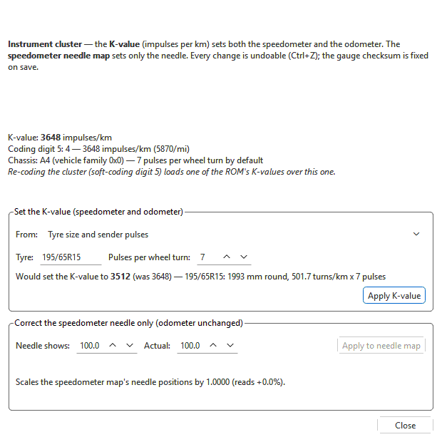

# Speed and distance

With a cluster EEPROM open, **Tools > VSS pulse settings...** (Ctrl+U) opens
**Speed & distance (cluster)**. It corrects the speedometer and odometer for
a different tyre size, a different gearbox sender, or a measured error.

Two different things can be wrong, and they are fixed in different places:

- **The K-value** (impulses per km) sets **both** the speedometer and the
  odometer. Change it for a different tyre size or sender, or when speed
  *and* distance read wrong.
- **The speedometer needle map** sets **only** the needle. Scale it when the
  odometer is right but the needle reads high or low — after a gauge face
  swap, or with a cluster from another model — and leave the odometer alone.

## What the dialog shows

The top of the dialog shows the cluster's current state:

- **K-value** — the value in the EEPROM, in impulses/km.
- **Coding digit 5** — the soft-coding digit that picks one of the ROM's own
  K-values, with the value it stands for.
- **Chassis** — the vehicle family, and the sender pulses per wheel turn it
  implies by default (7 on Golf / Jetta / Bora, 8 on Passat and most others).
- Warnings, in italics, when a K-value change would have no effect or would
  not last:
  - *Road speed is coded to come from CAN (ABS), so the K-value does not set
    the speedometer here.*
  - *Coding digit 5 is 0 (impulses via CAN).*
  - *Re-coding the cluster (soft-coding digit 5) loads one of the ROM's
    K-values over this one.* — so do not re-code the cluster with a scan tool
    after setting a K-value here.

## Setting the K-value

1. In **From:** pick how to work it out:

   | Method | Enter | New K-value |
   |---|---|---|
   | **Tyre size and sender pulses** | **Tyre** (for example `195/65R15`) and **Pulses per wheel turn** | wheel turns per km × pulses per turn |
   | **Tyre size change** | **Original tyre** and **New tyre** | the current K-value scaled by the ratio of the two rolling circumferences |
   | **Displayed vs actual speed** | **Displayed** and **Actual (GPS)** speed, same units | the current K-value × displayed ÷ actual |
   | **Odometer vs actual distance** | **Odometer** and **Actual distance** over the same trip, same units | the current K-value × odometer ÷ actual |

2. Read the line under the inputs: *Would set the K-value to **N** (was M)*,
   with the working (tyre circumference and turns per km, the circumference
   ratio, or how far off the reading is).
3. **Apply K-value**. The button is greyed when the result is the same as now
   or does not fit in 16 bits (1–65535).

## Correcting the needle only

1. Under **Correct the speedometer needle only (odometer unchanged)**, enter
   what the **Needle shows** and the **Actual** speed at the same moment.
2. The line below says what will change: the map's needle positions are
   scaled by actual ÷ shown.
3. **Apply to needle map**.

Some gauge faces (B5 Highline, R32, W8) have a speedometer map with two
slopes, broken around 100 km/h. For those the dialog says *This map has a
slope break (Highline face), so the speed points move instead of the needle
positions.* — the speed values of the map are scaled instead, which keeps
the break where it belongs.

## After a change

Each **Apply** is one undoable edit (Ctrl+Z). The window follows edits made
elsewhere — in the table, by undo, by a patch — while it is open. The K-value
and the speedometer map are covered by the gauge checksum, which is corrected
when you save; then write the file to the cluster (see
[Reading and writing the cluster](read-write.md)).

For the engine ECU's side of road speed, see
[VSS pulse settings](../../tools/vss.md).

The same values can also be edited directly in the tree: **K-value
(distance impulse number)** and **Speedometer calibration** under
**Gauges & speedometer** (see [The cluster EEPROM](eeprom.md)).
